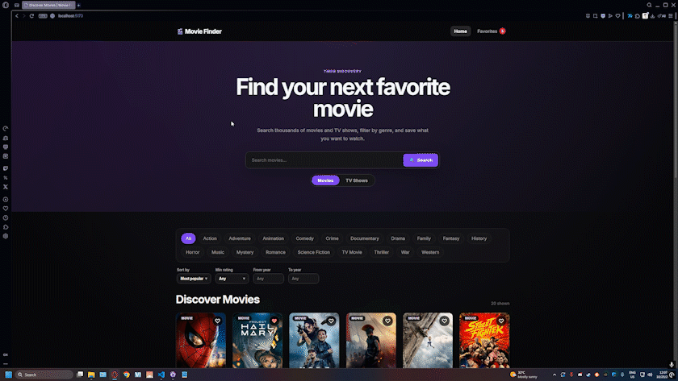

# Movie & TV Finder

A React and TypeScript app for discovering movies and TV shows, powered by the [TMDB](https://www.themoviedb.org/) API. Search, filter, sort, and save favorites, with shareable URLs for every search.



---

## Table of Contents

- [Features](#features)
- [Technologies](#technologies)
- [Getting Started](#getting-started)
- [Connecting to TMDB](#connecting-to-tmdb)
- [Deploying with the Serverless Proxy (Vercel)](#deploying-with-the-serverless-proxy-vercel)
- [Scripts](#scripts)
- [How It Works](#how-it-works)
- [Project Structure](#project-structure)
- [Known Limitations](#known-limitations)
- [Attribution](#attribution)
- [License](#license)

---

## Features

- **Movies and TV shows**, switched with a toggle
- **Live search** with a 400 ms debounce, so requests are sent once you stop typing
- **Infinite scroll**, plus a **Load more** button
- **Filters:** genre, minimum rating, and release-year range
- **Sorting:** most popular, highest rated, newest first, or oldest first
- **Shareable URLs.** A search such as `/?type=tv&genre=18&sort=rating&q=...` keeps its state after a refresh or when shared.
- **Details pages** at `/movie/:id` and `/tv/:id`
- **Favorites**, saved in the browser's `localStorage`. Movies and TV shows are stored separately, and you can filter the favorites page by type.
- **Caching.** Responses are cached for 5 minutes in memory and in `sessionStorage`.
- **Loading states.** Skeleton cards are shown while results load.
- **Accessible markup**, including ARIA attributes on the interactive controls.
- **Page titles** that update for each route.

---

## Technologies

- **React 19** and **TypeScript**
- **Vite 8** for development and builds
- **React Router 7** for routing, with search parameters as the source of filter state
- **Vitest**, **Testing Library**, and **jsdom** for tests
- **ESLint** for linting
- **Vercel serverless function** (optional) to keep the TMDB token on the server

---

## Getting Started

**Requirements:** a current Node.js LTS release, npm, and a [TMDB account](https://www.themoviedb.org/signup) for an API credential.

```bash
git clone <your-repository-url>
cd p5-movie-TV-discovery-app

npm install
cp .env.example .env     # then fill in ONE credential option (see below)
npm run dev
```

Open the local URL that Vite prints.

---

## Connecting to TMDB

Add **one** of these options to `.env`. The app checks them in this order: proxy, then read token, then legacy key.

| Option | Variable | When to use |
| --- | --- | --- |
| 1 | `VITE_TMDB_PROXY_URL=/api/tmdb` and the server-side `TMDB_READ_TOKEN` | Deployed sites. The token stays on the server. |
| 2 | `VITE_TMDB_READ_TOKEN` | Local development. The v4 token is sent as a Bearer header. |
| 3 | `VITE_TMDB_API_KEY` | The legacy v3 key. It works, but it is sent in the URL query string. |

For options 2 and 3, the value is bundled into the browser code, so it is visible to anyone who opens the page's network requests. Use option 1 for any public deployment.

Get your v4 **API Read Access Token** from TMDB under **Settings → API**.

---

## Deploying with the Serverless Proxy (Vercel)

The file `api/tmdb.ts` is a Vercel serverless function. It forwards requests to TMDB with your token added on the server.

1. Push the repository to Vercel. The `api/` folder is detected automatically.
2. In **Project Settings → Environment Variables**, add:
   - `TMDB_READ_TOKEN`: your v4 read token. Do **not** add the `VITE_` prefix.
   - `VITE_TMDB_PROXY_URL` = `/api/tmdb`
3. Redeploy.

To test the proxy locally, run `npx vercel dev` instead of `npm run dev`. It reads `TMDB_READ_TOKEN` from your `.env` file.

The proxy accepts only the read-only TMDB endpoints the app uses: popular titles, details, search, discover, and genre lists. Other paths return `403`, and methods other than `GET` return `405`.

---

## Scripts

| Command | What it does |
| --- | --- |
| `npm run dev` | Starts the development server |
| `npm run build` | Type-checks, then builds for production into `dist/` |
| `npm run preview` | Serves the production build locally |
| `npm run lint` | Runs ESLint |
| `npm test` | Runs the test suite once (Vitest) |
| `npm run test:watch` | Runs the tests in watch mode |

---

## How It Works

**State in the URL.** The search text, type, genre, sort, minimum rating, and year range are stored as URL parameters (`q`, `type`, `genre`, `sort`, `rating`, `from`, `to`). Changing a filter updates the URL, so the page can be refreshed or shared without losing its state.

**Data loading.** The app requests pages from TMDB through a single API client (`src/services/movieApi.ts`). The client picks a request method based on the credential option you configured. Results are cached for 5 minutes, and the cache is also kept in `sessionStorage` so it survives a refresh within the same tab.

**Infinite scroll.** A sentinel element at the bottom of the results loads the next page as it scrolls into view. The **Load more** button does the same thing for keyboard users and for browsers that don't scroll into view.

**Favorites.** Favorites are kept in `localStorage` under the key `movie-finder-favorites`. Each item records its media type, so a movie and a TV show with the same TMDB ID are stored as separate favorites. Entries saved before TV support was added are treated as movies.

---

## Project Structure

```text
p5-movie-TV-discovery-app/
├── api/
│   └── tmdb.ts              # Vercel serverless proxy for TMDB (keeps the token on the server)
├── public/
│   └── favicon.svg
├── src/
│   ├── components/          # cards, grid, skeletons, search bar, filters, sort, media toggle
│   ├── context/             # favorites provider and hook
│   ├── hooks/               # useDebounce, useInfiniteScroll, useDocumentMeta
│   ├── pages/               # Home, Details (movie and TV), Favorites, Not Found
│   ├── services/            # movieApi.ts (TMDB client), cache.ts, sortOptions.ts
│   ├── test/setup.ts        # Vitest setup
│   ├── types/movie.ts
│   ├── App.tsx              # routes
│   └── main.tsx
├── .env.example             # credential options
├── eslint.config.js
├── package.json
└── vite.config.ts
```

---

## Known Limitations

- **Browser-side credentials.** Options 2 and 3 put your TMDB key in the built JavaScript. Use the proxy (option 1) for any public site.
- **TMDB only.** Titles, posters, and ratings all come from TMDB, so the app is only as current as TMDB's data.
- **Favorites are local.** They are stored in one browser and are not synced between devices.
- **No user accounts.** The app has no login, and there is no server-side storage.

---

## Attribution

This product uses the TMDB API but is not endorsed or certified by TMDB.

---

## License

This project is licensed under the [MIT License](LICENSE).

---

## Author

Created by [bmarkjan-stack](https://github.com/bmarkjan-stack) as a portfolio project.